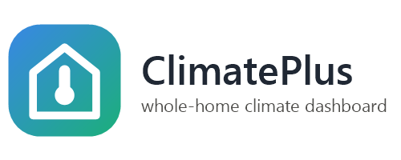

# ClimatePlus for Home Assistant



**ClimatePlus** is a Home Assistant app (add-on) that turns all climate-related
sensors in your home into one clear, good-looking dashboard: temperature,
humidity, CO₂ and other air quality sensors, light, thermostats, windows and
the weather — with live status, trends, history heatmaps and practical advice.

[![Add repository to Home Assistant][repo-badge]][repo-url]

## Features

| | |
|---|---|
| **Live overview** | House comfort score, indoor/outdoor temperature, humidity, dew point, air quality, sun position, lights and weather forecast, updated in real time over WebSocket. |
| **Room cards** | Per area (grouped by floor): temperature with 24 h sparkline and trend, humidity, CO₂, light, comfort score, heating status, open windows, lights and fans. |
| **Insights & advice** | Window open while heating, ventilate on high CO₂, *“airing helps / does not help”* based on absolute humidity indoor vs outdoor, mould risk in cold corners, too cold/warm, frost, large differences between rooms, stale/unavailable sensors and low batteries. |
| **Trends & history** | Compare all rooms for any metric over 24 h, 48 h, 7 d, 30 d or 1 year. Ranges > 7 days use Home Assistant long-term statistics. Min/max bands, comfort zone, crosshair tooltips and CSV export. |
| **Heatmap** | Hour × day heatmap for any sensor over 7/14/30 days, plus the average daily profile — instantly shows heating schedules, night setback and ventilation habits. |
| **Comfort chart** | Temperature × humidity scatter with your comfort zone and 24 h trails per room, a ventilation guide (g/m³ indoor vs outdoor) and a comfort table with dew point and estimated cold-corner humidity (fRsi 0.7). |
| **Room detail** | All sensors, derived values, devices and history charts with heating and window-open periods shaded. |
| **Sensor health** | Searchable list of every climate sensor with last report, battery level and status. |
| **Polished UI** | Light/dark theme (follows Home Assistant automatically), Dutch and English, mobile friendly, no external CDNs. |

Everything is discovered automatically from your **areas, floors and device
classes** — no YAML or card configuration needed.

## Installation

1. Click the button above, or in Home Assistant go to
   **Settings → Apps (Add-ons) → App store → ⋮ → Repositories** and add
   `https://github.com/martijntalens/ClimatePlus`.
2. Find **ClimatePlus** in the store and click **Install**.
3. Start the app and enable **Show in sidebar**.
4. Open **ClimatePlus** from the sidebar.

Want to look around first? Set the `demo_mode` option to `true` to explore the
dashboard with generated sample data.

See [climateplus/DOCS.md](climateplus/DOCS.md) for configuration options and
how sensors are detected.

## Security & privacy

- Access is **only through Home Assistant ingress** (authenticated by Home
  Assistant). No ports are exposed and requests from any other address than the
  ingress proxy are rejected.
- The app uses the Home Assistant API **read-only**: it reads states,
  registries, history and statistics and never changes devices or settings.
  The only service it calls is `weather.get_forecasts`, which returns data.
- No data leaves your Home Assistant host; there are no external requests or
  CDNs.

## Development

The backend is a small Python/aiohttp bridge (`climateplus/app/server.py`).
All dashboard logic (classification, comfort scoring, insights, charts) lives
in plain JavaScript under `climateplus/app/static/` without build steps.

- Open `climateplus/app/static/index.html?demo=1` from any static web server to
  work on the UI with demo data.
- To run the backend against a real Home Assistant:

  ```bash
  export HA_WS_URL=ws://homeassistant.local:8123/api/websocket
  export HA_TOKEN=<long-lived access token>
  export CLIMATEPLUS_OPTIONS=./options.json   # optional
  python3 climateplus/app/server.py
  ```

  Store the token in your shell session or a secrets manager, never in the
  repository.

## License

MIT — see [LICENSE](LICENSE).

[repo-badge]: https://my.home-assistant.io/badges/supervisor_add_addon_repository.svg
[repo-url]: https://my.home-assistant.io/redirect/supervisor_add_addon_repository/?repository_url=https%3A%2F%2Fgithub.com%2Fmartijntalens%2FClimatePlus
